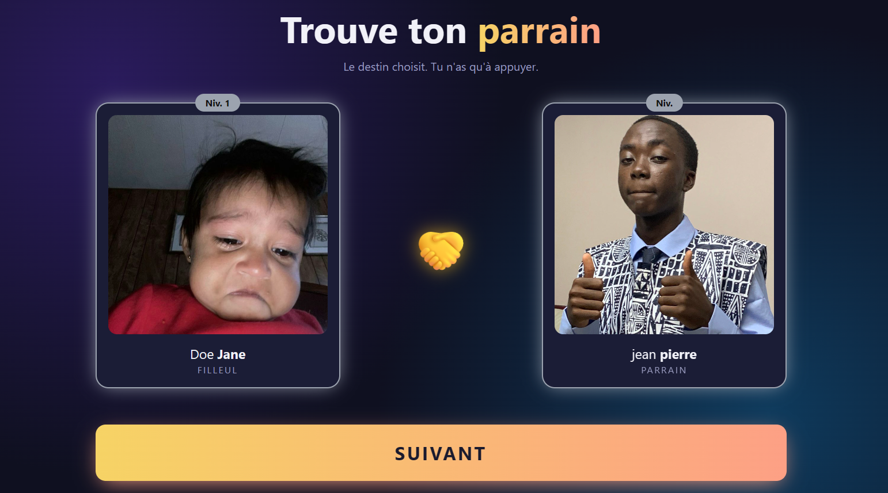

<div align="center">

# 🤝 Application de Parrainage

**Attribue un parrain à chaque filleul, façon gacha.**
Enregistre tes participants, lance le tirage, exporte le résultat en PDF.



</div>

---

## 📥 Récupérer le projet

Ouvre un terminal à l'endroit où tu veux placer le projet (par exemple ton Bureau), puis tape :

```bash
git clone https://github.com/Jonh-jonhy/app_parrainage.git
cd app_parrainage
```

La première ligne télécharge le projet dans un nouveau dossier, la seconde entre dedans. **Toutes les commandes de ce guide se lancent depuis ce dossier.**

> 💡 **Git n'est pas installé ?** Deux options :
> - Installe-le depuis [git-scm.com/downloads](https://git-scm.com/downloads), puis rouvre ton terminal.
> - Ou, sans Git : sur la page GitHub, clique sur **Code → Download ZIP**, puis **extrais** l'archive et ouvre le dossier obtenu. (plus simple)

---

## 📑 Sommaire

0. [Récupérer le projet](#-récupérer-le-projet)
1. [Présentation](#-présentation)
2. [Avant de commencer](#-avant-de-commencer)
3. [Installation](#-installation)
4. [Lancer l'application](#-lancer-lapplication)
5. [Utilisation pas à pas](#-utilisation-pas-à-pas)
6. [Réinitialiser le parrainage](#-réinitialiser-le-parrainage)
7. [Sauvegarder tes données](#-sauvegarder-tes-données)
8. [Problèmes fréquents](#-problèmes-fréquents)
9. [Pour les développeurs](#-pour-les-développeurs)

---

## ✨ Présentation

Cette application web permet de :

- 👥 **Enregistrer** des parrains et des filleuls (nom, prénom, photo)
- 🎰 **Tirer au sort** un parrain pour chaque filleul, avec une petite animation
- 📄 **Exporter en PDF** le tableau final « Filleul → Parrain »
- 🔄 **Recommencer** le parrainage à zéro quand tu le souhaites

Elle fonctionne **sur ton ordinateur**, dans ton navigateur, **sans connexion internet** une fois installée (internet n'est utile que pendant l'installation).

### Comment ça se passe, en bref

```text
 1. Installer (une seule fois)
          ↓
 2. Lancer l'application (à chaque utilisation)
          ↓
 3. Enregistrer les parrains et les filleuls  (page « Administration »)
          ↓
 4. Lancer le parrainage  (un clic par filleul)
          ↓
 5. Générer le PDF du résultat
```

---

## ✅ Avant de commencer

Vérifie ces trois points.

### 1. Python 3.12 ou plus récent est installé

Ouvre un terminal (voir encadré ci-dessous) et tape :

```bash
python --version
```

Tu dois voir quelque chose comme `Python 3.12.x` ou plus.

> 💡 **Python n'est pas installé, ou la version est trop ancienne ?**
> Télécharge-le sur [python.org/downloads](https://www.python.org/downloads/).
> **Pendant l'installation sous Windows, coche impérativement la case « Add python.exe to PATH »** (en bas de la première fenêtre). Sans elle, rien ne fonctionnera.

> ℹ️ Si `python` ne marche pas, essaie `py` (Windows) ou `python3` (macOS/Linux).

### 2. Tu sais ouvrir un terminal

| Système | Comment faire |
|---|---|
| **Windows** | Ouvre le dossier du projet dans l'Explorateur, clique dans la **barre d'adresse** en haut, tape `powershell` puis Entrée. Le terminal s'ouvre **directement dans le bon dossier** ✅ |
| **macOS** | Applications → Utilitaires → Terminal |
| **Linux** | `Ctrl + Alt + T` |

### 3. Tu es dans le bon dossier

Le dossier du projet est celui qui contient **`manage.py`** et **`requirements.txt`**. Vérifie-le :

**Windows :**
```powershell
dir
```
**macOS / Linux :**
```bash
ls
```

Tu dois voir `manage.py` dans la liste. Sinon, tu n'es pas au bon endroit.

---

## 📦 Installation

> ⏱️ À faire **une seule fois**. Compte 3 à 5 minutes.

Ouvre un terminal **dans le dossier du projet** (voir [Avant de commencer](#-avant-de-commencer)) et exécute les étapes **dans l'ordre**.

#### Étape 1 : Crée un environnement virtuel

Il garde les bibliothèques de ce projet séparées du reste de ton ordinateur.

```bash
python -m venv venv
```

Un dossier `venv` apparaît. Ne le modifie pas.

#### Étape 2 : Active-le

**Windows (PowerShell) :**
```powershell
venv\Scripts\Activate.ps1
```

**Windows (Invite de commandes / cmd) :**
```cmd
venv\Scripts\activate.bat
```

**macOS / Linux :**
```bash
source venv/bin/activate
```

✅ Tu dois voir **`(venv)`** au début de ta ligne de terminal. **Si tu ne le vois pas, les étapes suivantes échoueront.**

> ⚠️ Sous PowerShell, si le message parle de « l'exécution de scripts est désactivée », tape d'abord :
> ```powershell
> Set-ExecutionPolicy -Scope CurrentUser RemoteSigned
> ```
> Réponds `O` (oui), puis recommence l'activation.

#### Étape 3 : Installe les bibliothèques

```bash
pip install -r requirements.txt
```

Cela télécharge et installe tout ce qu'il faut (patiente, ça peut prendre une minute) :

| Bibliothèque | Version | Rôle |
|---|---|---|
| **Django** | 6.1.2 | Le framework de l'application |
| **Pillow** | 13.0.0 | Gestion des photos |
| **ReportLab** | 5.1.0 | Génération du PDF |
| asgiref, sqlparse, tzdata, charset-normalizer | | Dépendances nécessaires |

<details>
<summary>📋 Contenu du fichier <code>requirements.txt</code></summary>

```text
asgiref==3.13.0
charset-normalizer==3.5.2
Django==6.1.2
pillow==13.0.0
reportlab==5.1.0
sqlparse==0.6.0
tzdata==2026.5
```

</details>

#### Étape 4 : Crée la base de données

```bash
python manage.py migrate
```

Des lignes `Applying ... OK` défilent : c'est normal. Un fichier `db.sqlite3` est créé : **c'est là que seront stockées toutes tes données**.

#### Étape 5 : Crée ton compte administrateur

C'est ce compte qui te permettra d'enregistrer tes filleuls et tes parrains.

```bash
python manage.py createsuperuser
```

| Question | Que répondre |
|---|---|
| `Username` | Un identifiant de ton choix (ex. `admin`) |
| `Email address` | Tu peux laisser vide (Entrée) |
| `Password` | Ton mot de passe (**rien ne s'affiche quand tu tapes**) |
| `Password (again)` | Retape le même mot de passe |

> 🔐 **Note bien ces identifiants.** Si Django juge le mot de passe trop simple, réponds `y` pour le garder.

✅ **L'installation est terminée !**

---

## 🚀 Lancer l'application

À **chaque utilisation** :

**1. Ouvre un terminal dans le dossier du projet** et **active l'environnement virtuel** (étape 2 de l'installation, tu dois voir `(venv)`).

**2. Démarre le serveur :**

```bash
python manage.py runserver
```

Tu dois voir une ligne comme :

```text
Starting development server at http://127.0.0.1:8000/
```

**3. Ouvre ton navigateur à l'adresse :**

👉 **http://127.0.0.1:8000/**

**Pour arrêter** l'application : retourne dans le terminal et appuie sur `Ctrl + C`.

---

## 🎮 Utilisation pas à pas

### 🗺️ Les adresses à connaître

| Adresse | Page |
|---|---|
| `http://127.0.0.1:8000/` | Accueil |
| `http://127.0.0.1:8000/admin/` | Administration (saisie des parrains et filleuls) |

### 1️⃣ Page d'accueil

Deux grands boutons :

| Bouton | Action |
|---|---|
| 🛠️ **Administration** | Ouvre l'espace où tu enregistres tes parrains et filleuls |
| 🎰 **Lancer le parrainage** | Ouvre la page de tirage |

### 2️⃣ Enregistrer les parrains et les filleuls

1. Clique sur **Administration**.
2. Connecte-toi avec le compte créé pendant l'installation.
3. Dans le bloc **Parrainage**, tu vois deux lignes : **Parrains** et **Filleuls**.
4. Clique sur **Ajouter** à côté de **Parrains**.
5. Remplis le formulaire (nom, prénom, photo si tu en as une, et capacité si le champ est présent), puis clique sur **Enregistrer**.
6. Recommence pour **chaque parrain**, puis pour **chaque filleul** (ligne **Filleuls**).

> 💡 **Astuce** : utilise le bouton **« Enregistrer et ajouter un nouveau »** pour saisir plusieurs personnes à la suite, sans revenir en arrière.
>
> 💡 **Corriger une erreur** : clique sur le nom de la personne dans la liste, modifie, puis **Enregistrer**. Pour supprimer, ouvre la fiche puis clique sur **Supprimer** (en bas, en rouge).
>
> ⚠️ **Ne touche pas** à la section « Authentification et autorisation » (si elle apparaît) : elle gère les comptes de connexion, pas tes participants.

**Avant de lancer le tirage, vérifie :**

- ✅ Tous tes parrains sont enregistrés
- ✅ Tous tes filleuls sont enregistrés
- ✅ Il y a assez de places chez les parrains pour accueillir tous les filleuls
- ✅ Aucun filleul n'a déjà un parrain (sinon, voir [Réinitialiser](#-réinitialiser-le-parrainage))

### 3️⃣ Lancer le parrainage

1. Retourne à l'accueil.
2. Clique sur **Lancer le parrainage**.
3. La page affiche un **filleul à gauche**, une **carte mystère `?` à droite**, et une poignée de main au milieu.
4. Clique sur le grand bouton **Parrainer** : la poignée de main tremble pendant une seconde, puis **le parrain est révélé**.
5. Recommence jusqu'à ce que **tous les filleuls aient un parrain**.

> ⚠️ **Ne rafraîchis pas la page** (F5) juste après un tirage, et **ne clique pas deux fois** sur le bouton : attends la fin de l'animation.

### 4️⃣ Parrainage terminé : le PDF

Quand tout le monde a un parrain, la page **« Parrainage terminé »** s'affiche.

Clique sur **📄 Générer le PDF** : un tableau s'ouvre dans ton navigateur.

| Filleul | Parrain |
|---|---|
| Prénom Nom | Prénom Nom |

**Pour l'enregistrer ou l'imprimer**, utilise les boutons du lecteur PDF de ton navigateur (en haut ou en bas de la page), ou `Ctrl + S` / `Ctrl + P`.

---

## 🔄 Réinitialiser le parrainage

Tu veux **tout recommencer** (nouvelle promotion, nouveau tirage) ? Cette opération **retire le parrain de chaque filleul**.

| Ce qui est effacé | Ce qui est conservé |
|---|---|
| ❌ Les liens « filleul → parrain » | ✅ Les parrains enregistrés |
| | ✅ Les filleuls enregistrés |
| | ✅ Les photos |

> ⚠️ **Cette action est irréversible.** **Génère et enregistre le PDF avant** si tu veux conserver le résultat actuel.

### Méthode rapide : une seule commande

Terminal ouvert dans le dossier du projet, avec l'environnement virtuel **activé** (`(venv)` visible) :

```bash
python manage.py shell -c "from parrainage.models import Filleul; print(Filleul.objects.exclude(parrain=None).update(parrain=None), 'filleul(s) réinitialisé(s)')"
```

Elle affiche le **nombre de filleuls remis à zéro**. Par exemple : `12 filleul(s) réinitialisé(s)`.

### Méthode pas à pas : dans le shell Django

```bash
python manage.py shell
```

Puis colle ceci :

```python
from parrainage.models import Filleul

for filleul in Filleul.objects.all().exclude(parrain=None):
    filleul.parrain = None
    filleul.save()
    print(filleul.parrain)
```

Appuie **deux fois sur Entrée** après la dernière ligne pour valider. Chaque filleul traité affiche `None`, ce qui confirme qu'il n'a plus de parrain.

Pour quitter le shell : tape `exit()` puis Entrée.

✅ Tu peux ensuite **relancer un tirage** depuis la page d'accueil.

---

## 💾 Sauvegarder tes données

Toutes tes données tiennent dans **deux éléments** à la racine du projet :

| Élément | Contenu |
|---|---|
| **`db.sqlite3`** | Les parrains, les filleuls, les comptes, les liens de parrainage |
| **`media/`** | Les photos téléversées |

**Pour sauvegarder** : application **fermée**, copie ces deux éléments sur une clé USB ou un autre dossier.

**Pour restaurer** : remplace-les dans le dossier du projet par ta copie.

> 💡 Fais une copie **avant** chaque réinitialisation et **après** chaque grosse saisie.

---

## 🆘 Problèmes fréquents

| Symptôme | Cause probable | Solution |
|---|---|---|
| `python : commande introuvable` ou *« Python est introuvable »* | Python absent du PATH | Réinstalle Python en cochant **« Add python.exe to PATH »**, ou essaie `py` / `python3` |
| `No module named django` | Environnement virtuel non activé | Active-le : le `(venv)` doit apparaître au début de la ligne |
| `can't open file ... manage.py` / `No such file` | Mauvais dossier | Place-toi dans le dossier qui contient `manage.py` |
| Le `venv` copié depuis un autre ordinateur ne marche pas | Un `venv` n'est **pas transportable** | Supprime le dossier `venv`, puis refais l'installation |
| `Error: That port is already in use` | L'application tourne déjà (autre fenêtre) | Ferme l'autre fenêtre noire, ou lance `python manage.py runserver 8001` puis va sur `http://127.0.0.1:8001/` |
| Impossible de se connecter à l'administration | Identifiants oubliés | `python manage.py changepassword ton_identifiant`, ou crée un nouveau compte avec `python manage.py createsuperuser` |
| La page est sans style (pas de couleurs) | Serveur démarré avant la création du dossier `static` | Arrête (`Ctrl+C`), relance `runserver`, puis `Ctrl + F5` dans le navigateur |
| Les photos ne s'affichent pas | Mode développement désactivé ou dossier manquant | Vérifie `DEBUG = True` dans `settings.py` et la présence du dossier `media/` |
| Le tirage dit qu'il n'y a plus de place | Pas assez de capacité chez les parrains | Ajoute des parrains ou augmente leur capacité dans l'administration |
| Le tirage ne propose aucun filleul | Tous ont déjà un parrain | Réinitialise le parrainage (voir plus haut) |
| Le PDF est vide | Aucun filleul enregistré | Ajoute des filleuls dans l'administration |
| `Forbidden (403) CSRF verification failed` | Page restée ouverte trop longtemps | Recharge la page (`F5`) et recommence |
| `OperationalError: no such table` | La base n'a pas été créée | Lance `python manage.py migrate` |

**Rien ne marche ?** Ferme tout, rouvre un terminal dans le dossier du projet, active le `venv`, puis lance :

```bash
python manage.py check
```

Il signale la plupart des erreurs de configuration. Envoie le message obtenu à la personne qui t'a fourni l'application.

---

## 🛠️ Pour les développeurs (Mon Bro, tu n'as pas besoin de lire ça !!)

### Structure du projet

```text
projet/
├── manage.py                   # point d'entrée des commandes Django
├── requirements.txt            # bibliothèques à installer
├── README.md
├── db.sqlite3                  # base de données (créée par « migrate »)
├── media/                      # photos téléversées
├── docs/
│   └── apercu.png              # capture d'écran du README
├── venv/                       # environnement virtuel (NE PAS PARTAGER)
├── config/                     # réglages du projet (settings.py, urls.py)
└── parrainage/
    ├── models.py               # Parrain, Filleul
    ├── views.py                # accueil, tirage, terminé, pdf
    ├── urls.py                 # routes de l'application
    ├── admin.py                # configuration de l'administration
    ├── migrations/             # historique de la base de données
    ├── static/parrainage/      # style.css
    └── templates/parrainage/   # base.html, accueil.html, tirage.html, termine.html
```

> Adapte les noms des dossiers (`config/`, `parrainage/`) à ceux de ton projet.

### Partager l'application

Le dossier `venv/` est **propre à ton ordinateur** et très volumineux. **Ne l'envoie pas.** Avant de zipper le projet :

1. **Exclus** : `venv/`, tous les dossiers `__pycache__/`.
2. **Exclus** `db.sqlite3` et `media/` si tu ne veux pas transmettre tes données de test (l'utilisateur en créera de nouveaux avec `migrate`).
3. **Inclus** : `manage.py`, `requirements.txt`, `README.md`, `docs/`, et les dossiers `config/` et `parrainage/`.

Si tu utilises Git, ajoute ceci à un fichier `.gitignore` :

```gitignore
venv/
__pycache__/
*.pyc
db.sqlite3
media/
```

### Technologies

- **Django 6.1** (backend, ORM, administration)
- **SQLite** (base de données, aucun serveur à installer)
- **Pillow** (photos) et **ReportLab** (PDF)
- **HTML / CSS / JavaScript** natifs pour l'interface

### Commandes utiles

```bash
python manage.py runserver        # lancer le serveur
python manage.py makemigrations   # préparer une modification des modèles
python manage.py migrate          # appliquer les modifications à la base
python manage.py createsuperuser  # créer un compte administrateur
python manage.py changepassword   # changer un mot de passe
python manage.py check            # détecter les erreurs de configuration
python manage.py shell            # console Python avec accès aux modèles
python manage.py dbshell          # ouvrir la base en ligne de commande
```

### ⚠️ Avertissement

Cette application est conçue pour un **usage local**. Pour la mettre en ligne, il faudrait au minimum : passer `DEBUG = False`, définir `ALLOWED_HOSTS`, utiliser une `SECRET_KEY` secrète, et faire servir les fichiers statiques et médias par un vrai serveur web.

---

<div align="center">

Fait par KAMDEM Marcel Jonathan avec 🐍 Python et Django

</div>